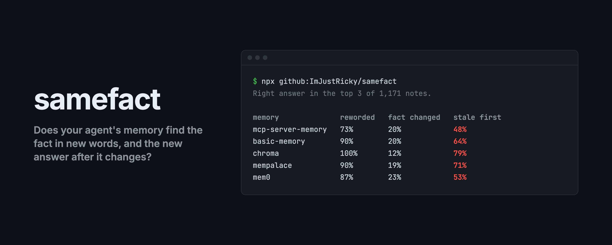
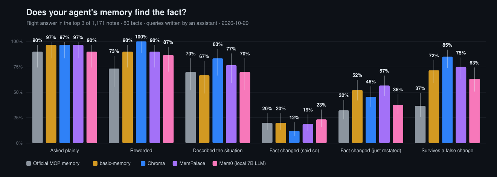

**Does your AI agent's memory find a fact when you ask in different words, and give you the new answer after the fact changes?**

```bash
npx github:ImJustRicky/samefact --quick                          # seconds
npx github:ImJustRicky/samefact -- uvx your-memory-mcp-server    # test any MCP memory server
```

Agents forget everything between sessions, so they lean on memory tools. You tell your assistant something once, and it should find it later. But later nobody asks in the same words, and facts change: tests move to Vitest, standup moves to 10:15, the dentist is someone new.

samefact tests exactly those two things, over MCP, against any memory server. It needs no accounts and no API keys (only memories that run an LLM themselves, like Mem0, need one), and most servers finish in a few minutes.

## Results (2026-10-29)

Right answer in the top 3 of 1,171 stored notes. Each question goes through the search query an assistant would write for it, since that's how agents use memory. A random pick would get 0.3%.

| Memory                                                                                           | Asked plainly | Reworded | Situation described | **Fact changed (said so)** | Old answer first | Fact changed (restated) | Survives a false change |
| ------------------------------------------------------------------------------------------------ | ------------- | -------- | ------------------- | -------------------------- | ---------------- | ----------------------- | ----------------------- |
| [Official MCP memory](https://github.com/modelcontextprotocol/servers/tree/main/src/memory) 1.0¹ | 90%           | 73%      | 70%                 | **20%**                    | 48%              | 32%                     | 37%                     |
| [basic-memory](https://github.com/basicmachines-co/basic-memory) 0.24.1                          | 97%           | 90%      | 67%                 | **20%**                    | 64%              | 52%                     | 72%                     |
| [Chroma](https://github.com/chroma-core/chroma-mcp) 0.2.6                                        | 97%           | 100%     | 83%                 | **12%**                    | 79%              | 46%                     | 85%                     |
| [MemPalace](https://github.com/MemPalace/mempalace) 3.11                                         | 97%           | 90%      | 77%                 | **19%**                    | 71%              | 57%                     | 75%                     |
| [Mem0](https://github.com/mem0ai/mem0) 2.2.1²                                                    | 90%           | 87%      | 70%                 | **23%**                    | 53%              | 38%                     | 63%                     |

¹ Its search is a substring match, so samefact sends it one search per keyword of the query and ranks notes by keywords matched. Each note is stored as its own entity; relations aren't used.

² Run with a local 7B model (Qwen2.5-7B-Instruct, 4-bit) for its LLM step; see [Limits](#limits).

Every memory is driven the same simple way: store each note as it comes, then search. None is told which note is newer, and no update or delete tools are used, because that's how most agents use them today. Vendors are welcome to send adapters that do more.

30 questions per kind for facts that never change, 90 for changed facts (30 facts asked three ways), 60 for false changes (20 facts). Questions about the same fact aren't independent, so treat gaps under about 10 points as ties. 95% ranges for every number, the second question set and the other query style are in [`results/latest.json`](results/latest.json).

**Searched with the question exactly as typed**, with no assistant rewriting it:

| Memory              | Asked plainly | Reworded | Situation described | Fact changed (said so) |
| ------------------- | ------------- | -------- | ------------------- | ---------------------- |
| Official MCP memory | 90%           | 30%      | 27%                 | 8%                     |
| basic-memory        | 97%           | 47%      | 30%                 | 14%                    |
| Chroma              | 100%          | 87%      | 53%                 | 16%                    |
| MemPalace           | 97%           | 63%      | 53%                 | 19%                    |
| Mem0                | 87%           | 47%      | 40%                 | 24%                    |



### What it shows

1. **Rephrased facts are found when an assistant writes the search query.** Asked plainly, every memory gets 90–97%; reworded, 73–100%; describing a situation instead of naming the topic, 67–83%. Searched with the user's own words instead, reworded questions fall to 30–87%, and the official memory and basic-memory lose about half.
2. **None of them, used this simple way, reliably gives you the new answer after a fact changes.** When the user says outright that something changed ("Heads up, I'm seeing Dr. Vasquez-Lim for teeth stuff these days"), the new answer comes first at most 23% of the time, and the old one comes first 48–79% of the time. Mem0, which runs every note through an LLM that decides what to add or update, scores about the same.
3. **A terse restatement does better than an announced change** ("Dentist: Dr. Vasquez-Lim." scores 32–57%), probably because a short note sits closer to a short query. That's an accident of ranking, not memory.

## The test

The facts, questions and search queries were written blind: separate language models each saw only what their file needed, never the memory servers or the results. The only part the author wrote is the templates behind 417 of the background notes. Nothing was tuned against any memory.

- **80 facts** a person or a team tells an assistant ([`data/facts.json`](data/facts.json)): 40 personal, 40 work. 40 have look-alikes stored next to them ("The kids' orthodontist is Dr. Haldane." next to "My dentist is Dr. Okonkwo over on Fairview"). **30 change later**, written two ways and tested in separate runs: said so in the user's own words, and just restated with no word saying it changed. **20 have a false change** that must leave the fact alone, such as "Thinking about renaming the guest network to something funnier, but honestly can't be bothered."
- **Two independent sets of questions** per fact ([`data/questions.json`](data/questions.json)), three kinds each:

  | Kind                | For "Leo gets out of school at 2:50 on weekdays."                          |
  | ------------------- | -------------------------------------------------------------------------- |
  | Asked plainly       | What time does Leo get out of school?                                      |
  | Reworded            | When do I need to collect my son from class these days?                    |
  | Situation described | I've got an appointment this afternoon. When do I need to be back for Leo? |

- **The search query** an assistant would send for each question ([`data/agent-queries.json`](data/agent-queries.json)), written by six separate writers that each saw one question per fact, so none could carry knowledge from one question to another.
- **1,000 background notes** ([`data/noise.json`](data/noise.json)): 583 written as a person would, 417 from templates ([`scripts/make-noise.ts`](scripts/make-noise.ts)); none contains an answer.

A question counts when the right value is in the top 3 results, as a whole word ("Bun" doesn't match "bundle"). After a change, the new value must also rank above the old one. **Old answer first** is how often the old value ranked above the new.

## Test your own memory

```bash
npx github:ImJustRicky/samefact -- <command that starts your MCP server>
```

samefact finds your store and search tools from their names and schemas and prints what it picked. If it guesses wrong, name them, and pass any extra arguments your tools need:

```bash
samefact --store add_memory.content --search search_memory.query \
         --search-extra '{"user_id":"test"}' -- uvx my-memory-server
```

**In CI**, fail the build when memory regresses. The names are `direct` (asked plainly), `reworded`, `situational`, `update` (fact changed), `stale` (old answer first, a maximum) and `decoy` (false change):

```bash
samefact --quick --min update=0.5 --min reworded=0.8 --min decoy=0.9 -- node dist/server.js
```

**With your own facts**: `--data DIR`, with the same files as [`data/`](data). An earlier 40-fact set the author wrote is in [`data/dev`](data/dev), for developing memory rules without touching the test.

Other options: `--quick` (no background notes; seconds, and easier than a full run), `--updates explicit|implicit|both`, `--set main|heldout|both`, `--style asked|agent|both`, `--failures` (every miss, with the answer it wanted and what came back), `--json`, `--out DIR`, `--list`. Built-in servers that run on Python need [uv](https://docs.astral.sh/uv/); Mem0 needs an OpenAI-compatible endpoint in `SAMEFACT_LLM_URL` and `SAMEFACT_LLM_MODEL`. Each results file records the samefact version, a hash of the test data, and the name and version every server reported about itself (the table lists the package versions samefact installs). A server whose searches mostly error out is reported as failed, never as 0%.

## The reference memory

[`src/memory`](src/memory) is a small MCP memory server (MiniLM embeddings, no LLM) that tries to handle changes, as a baseline to beat and a place to try ideas. It's kept out of the table above because it was built alongside the test. Its rules ([`change.ts`](src/memory/change.ts)) mark an older note replaced when a newer one says it changed in everyday words ("bumped", "rebooked", "these days") or states a new value about the same thing, unless the newer one is hypothetical ("thinking about", "should"); the same check runs on notes a search returns together.

Its store-time rule was written on the earlier set in [`data/dev`](data/dev) and checked on [`data/validation.json`](data/validation.json). The recall-time check was added while the current test set was being written, but before any results on it. On this test set:

|                           | Asked plainly | Reworded | Situation | Changed (said so) | Old answer first | Changed (restated) | False change |
| ------------------------- | ------------- | -------- | --------- | ----------------- | ---------------- | ------------------ | ------------ |
| reference memory          | 93%           | 93%      | 77%       | 36%               | 53%              | 67%                | 87%          |
| same, change tracking off | 100%          | 100%     | 83%       | 12%               | 79%              | 48%                | 85%          |

Change tracking triples the right answers after a stated change, but costs a few points on facts that never changed, because some false replacements happen. On 20 further unseen cases ([`data/test-replace.json`](data/test-replace.json)) its rule catches 10 of 20 stated changes and 3 of 20 restatements. Rules get part of the way; recognizing change in people's own words looks like a job for a model. Run it in any MCP client with `npx -y -p github:ImJustRicky/samefact samefact-memory`.

## How it compares

|                             | samefact                                | LongMemEval / LoCoMo      | MemoryAgentBench    | Vendor benchmarks |
| --------------------------- | --------------------------------------- | ------------------------- | ------------------- | ----------------- |
| Runs against any MCP server | yes, no code                            | no                        | no                  | no                |
| Needs an LLM or API keys    | no (only LLM-based memories do)         | yes (judge)               | yes                 | yes               |
| Time to run                 | minutes; seconds with `--quick`         | hours                     | hours               | hours             |
| Changes scored strictly     | said, restated, false; old answer first | knowledge-update category | conflict resolution | varies            |
| CI mode                     | yes                                     | no                        | no                  | no                |

It's smaller and narrower than those: it checks retrieval, not the final answer a model gives.

## Limits

- **Retrieval only.** It checks whether the right note comes back in the top 3, not what a model then says. A memory that returns both the old and new note may still lead a model to the right answer.
- **One way of driving each server.** Built-in adapters store each note with the server's main write tool and search with its main search tool; they don't use update or delete tools, titles or links. Vendors are welcome to send better adapters.
- **Mem0 ran on a local 7B model** (Qwen2.5-7B-Instruct, 4-bit) rather than the larger hosted models it's usually paired with. 5 of 1,171 notes failed its extraction step and weren't stored, as they would be for a user with that setup. A full run took 55 minutes, against a few minutes for the others.
- **Answers must match exactly.** A memory that rewrites notes (Mem0 does) loses the question if it turns "$650" into "650 dollars".
- **The test set is written by language models.** It's realistic but not real user data, and English only.

## Develop

```bash
git clone https://github.com/ImJustRicky/samefact && cd samefact && npm install
npm test                         # scoring, data integrity, the reference memory's change rules
npm run bench                    # full run
npm run chart && npm run banner  # images from results/latest.json
```

MIT licensed.
